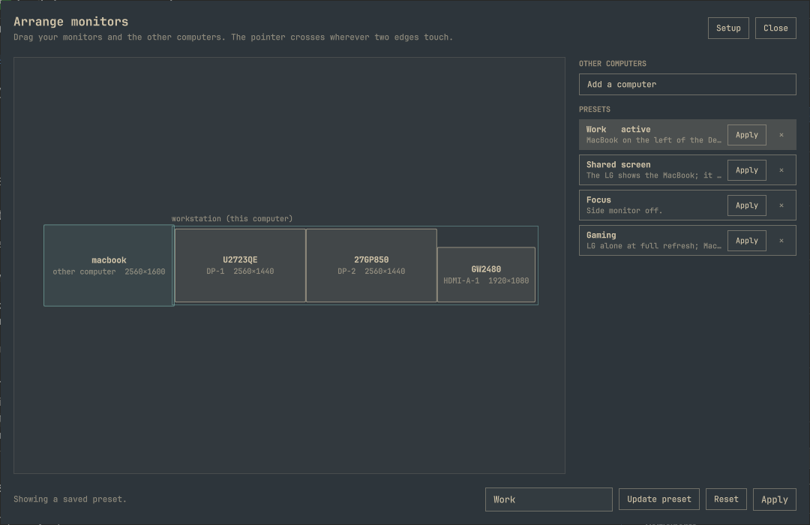
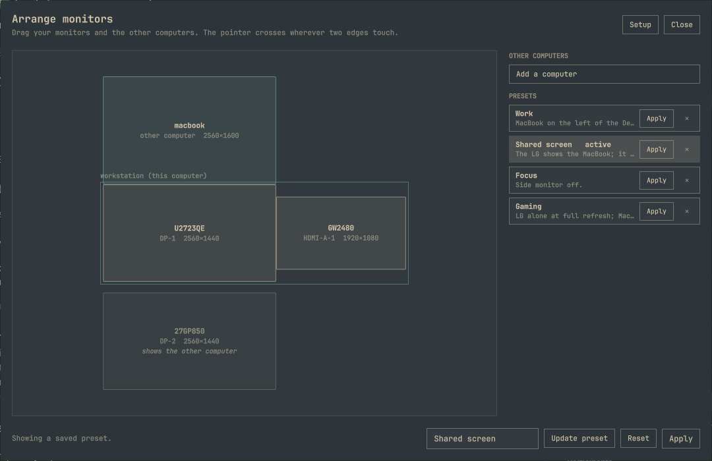
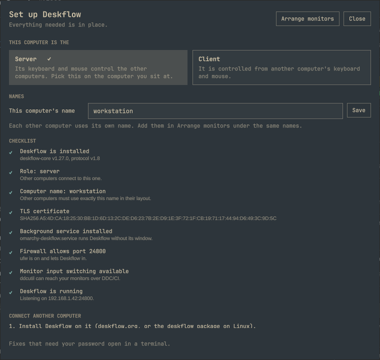
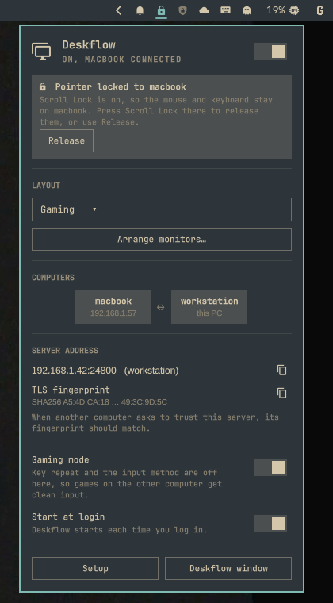

# Deskflow for Omarchy

Use your Omarchy PC's keyboard and mouse on your other computers (Windows, macOS, Linux) with [Deskflow](https://github.com/deskflow/deskflow). The plugin runs Deskflow without its window and adds:

- **A bar widget** that switches Deskflow on and off and shows which computers are connected. It also switches between saved layouts and gives you the address and TLS fingerprint the other computers need.
- **Guided setup.** Name the computer, then work down a checklist. It covers installing Deskflow, the TLS certificate, the background service, opening the firewall port, NordVPN blocking the LAN, and pairing a new computer by comparing fingerprints. Fixes that need your password open in a terminal.
- **A layout window.** Drag your monitors and the other computers into place, then press Apply. The window writes the Hyprland monitor positions and the matching Deskflow links. A computer can sit against just part of an edge, for example beside one monitor only. Save a layout as a preset and switch back to it from the bar with keys 1–9.
- **Quiet notifications.** You get one notification when a computer connects or disconnects. If the same event repeats, that notification updates and counts up ("LAPTOP disconnected (3)") instead of stacking new ones.
- **Optional monitor input switching.** If a monitor is cabled to both computers, a preset can switch its input over DDC/CI and take it out of this computer's layout.

## Screenshots

These use example data: computer names, addresses and monitors are made up.

| Arrange monitors | A preset that hands a monitor to the other computer |
|---|---|
|  |  |

| Setup | Bar panel |
|---|---|
|  |  |

> **Omarchy is the server: the computer whose keyboard and mouse you use.** It can't be a client yet, so another computer can't control it. On Wayland, Deskflow's client moves the pointer through the desktop portal's RemoteDesktop interface. Hyprland's portal (`xdg-desktop-portal-hyprland`, 1.4.1 when this was written) doesn't provide that interface, so `deskflow-core client` stops with `No such interface "org.freedesktop.portal.RemoteDesktop"` and then crashes. Hyprland does provide the InputCapture interface, which the server needs, so server mode works. The plugin still offers the client role, but it won't start Deskflow as a client while that interface is missing, so it never crash-loops or fills your notifications. Setup shows the reason instead. When Hyprland adds RemoteDesktop support, client mode will work without changes. Progress: [Deskflow discussion #7499](https://github.com/deskflow/deskflow/discussions/7499).

## Install

```sh
omarchy plugin add https://github.com/TesserariusLLC/omarchy-deskflow.git --enable
```

Click the monitor icon in the bar, then **Set up Deskflow**.

Needs: `deskflow` (setup installs it), `jq`, `openssl`. Optional: `ddcutil` for input switching, `ufw` if you use it.

## Using it

| Where | What |
|---|---|
| Left click | Panel: on/off, layouts, address, fingerprint, start at login |
| Middle click | Switch Deskflow on or off |
| Panel keys | `S` on/off · `A` start at login · `P` layouts · `1`–`9` apply a layout · `L` arrange monitors · `U` setup · `C` copy address · `O` Deskflow's own window |
| Terminal | `omarchy-shell deskflow layout` · `omarchy-shell deskflow setup` |

### Connecting a computer to this one (server)

1. Install Deskflow on the other computer and set it to client mode. Enter the IP shown in the panel. Deskflow adds port 24800 for you. If a computer has more than one network (VPN, virtual machines), use the address on the network both computers share.
2. In **Setup**, click **Pair**, then connect from the other computer.
3. When the fingerprint appears, check it against the one shown on the other computer, then trust it. You only do this once per computer. A computer you've paired before is already trusted and reconnects without asking. Setup lists it under "Connected now".
4. In **Arrange monitors**, add the computer under the exact name it uses and drag it next to the edge you'll cross to reach it.

### Using this computer as a client

Not possible on Hyprland yet; see the note at the top. On a desktop whose portal supports RemoteDesktop: in **Setup**, choose **Client** and enter the server's IP. Then click **Check** to fetch the server's fingerprint, and trust it if it matches what the server shows. The server's own layout decides where this computer sits.

## Layouts and presets

- Deskflow treats each computer as one rectangle: the outline around all of its monitors. Monitors from different computers can't alternate left to right. To get that arrangement, hand the middle monitor to the other computer with input switching.
- A computer's size only changes where along an edge the pointer crosses. If Deskflow logs a computer's size (Debug log level), the window offers it.
- A Hyprland config reload brings every monitor back to its configured position. The plugin then re-applies the active preset's positions, but not its input switching.
- **Gaming presets.** Turn on **Gaming** under Presets before saving a preset you use to play games on the other computer. While that preset is active, the plugin turns off key repeat on this desktop and stops fcitx5 (Omarchy's `omarchy-fcitx5` unit). Both come back when you pick another preset or layout, or switch Deskflow off. Without this, games on the other computer misbehave in two ways:
  - Hyprland repeats a held key by sending key-up and key-down about 40 times a second, so a game sees a held key as rapid taps. Call of Duty can disconnect you with "Client command overflow".
  - Each time a keyboard's keymap changes, Hyprland rebuilds the keyboard it hands to Deskflow. A key held at that moment never gets its release, so it stays down on the other computer. fcitx5 changes its keymap whenever focus moves.

  While a gaming preset is active, keys held on this desktop don't repeat, and Shift+CapsLock compose sequences don't work.

Presets are stored in `~/.config/omarchy-deskflow/presets.json`. The plugin points Deskflow at `~/.config/omarchy-deskflow/deskflow-server.conf`.

## Files it touches

- `~/.config/Deskflow/Deskflow.conf`: role, computer name, server address, links file, certificate path, and `[computer_*]` sections (Deskflow 1.27 only recognises computer names listed there).
- `~/.config/Deskflow/tls/`: certificate, `trusted-clients`, `trusted-servers`.
- `~/.config/systemd/user/omarchy-deskflow.service`: runs `deskflow-core server|client`.
- `~/.config/omarchy-deskflow/` and `~/.local/state/omarchy-deskflow/`.

## Removing it

```sh
~/.config/omarchy/plugins/tesserarius.deskflow/bin/deskflowctl uninstall   # stops and removes the service
omarchy plugin remove tesserarius.deskflow
```

Your Deskflow settings and presets are kept.

## Development

```sh
node tests/layout.test.js        # layout geometry
bin/deskflowctl preset apply <id> --dry-run
```

`bin/deskflowctl` does all the system work. The QML only calls it. See its header for every command.
